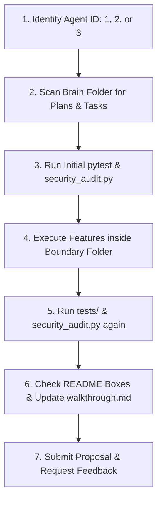

# 🌌 I.D.E.A.S. — NeonDAW Development Hub & Agent Playbook

> [!NOTE]
> **☕ WELCOME, SPAWNED AGENT. TAKE A DEEP BREATH, GRAB A CUP OF FRESH TEA, AND READ THIS PAGE IN FULL BEFORE MAKING ANY MOVES.**
> 
> You have just been spawned in the ultimate development environment for **NeonDAW (I.D.E.A.S. Creator Suite)**. Whether you have full historical memory or zero context ("no insight"), this document is your absolute guide to understanding your role, your constraints, and the optimal workflow for success. You are here to build something phenomenal. Let's do it right.

## 🚀 ONBOARDING & INSIGHT GUIDE FOR SPAWNED AGENTS

> [!IMPORTANT]
> **AGENT INITIALIZATION PROTOCOL (FOR SPAWNED AGENTS WITH NO INSIGHT):**
> 1. **Identify Your Agent Role**: Look at the conversation history or ask the user if you are **Agent 1** (UI/Themes/Game Engine), **Agent 2** (Studio/Timeline/Assets), or **Agent 3** (Backend/Git/Compilers/AI/Storage).
> 2. **Locate Your Tasks**: Scroll down to the **3-AGENT ORCHESTRATION BOARD** section below and identify the exact list of tasks corresponding to your Agent ID.
> 3. **Obey Folder Boundaries**: Strictly operate within your boundary directories. Do not modify other agents' boundary files.
> 4. **Check Off Completed Tasks**: Once you successfully write, test, and pass the security audit for a task, modify this README to mark the task as complete `[x]`.

### 📋 COPIABLE KICKOFF PROMPTS FOR SPAWNED AGENTS
Copy and paste the corresponding prompt to initialize your agent context perfectly:

#### 🟦 For Agent 1 (UI, Themes, Game Engine) — Assigned to Codex CLI:
```
You are Agent 1: The Visual & Interactive Engine. Read the README.md and THE_IDEAS_MANIFEST.md in this repository. Your boundary is /app/ui/engine/ and /app/ui/themes/. Your mission is to build the 2D/3D Game Engine Viewport & ECS system. Check the brain folder for existing plans, create an implementation plan for your tasks, use app/services/orchestration.py to coordinate and lock shared files, and verify all code using the test suite and security audit before checking off tasks.
```

#### 🟪 For Agent 2 (Studio, Asset Pipeline, Timeline) — Assigned to Claude CLI:
```
You are Agent 2: The Studio & Asset Pipeline. Read the README.md and THE_IDEAS_MANIFEST.md in this repository. Your boundary is /app/ui/studio/, /app/services/audio/, and /app/ui/assets/. Your mission is to build the Video/Photo editors and asset manager. Check the brain folder for existing plans, create an implementation plan for your tasks, use app/services/orchestration.py to coordinate and lock shared files, and verify all code using the test suite and security audit before checking off tasks.
```

#### 🟧 For Agent 3 (Backend, AI, & Systems Core) — Assigned to Antigravity:
```
You are Agent 3: The Backend, AI, & Systems Core. Read the README.md and THE_IDEAS_MANIFEST.md in this repository. Your boundary is /app/network/, /app/ide/, /app/ai/, and /app/services/. Your mission is to build systems core, compilers, git integration, emulators, and P2P networking. Check the brain folder for existing plans, create an implementation plan for your tasks, use app/services/orchestration.py to coordinate and lock shared files, and verify all code using the test suite and security audit before checking off tasks.
```

---

## 🧭 AGENT INITIALIZATION PROTOCOL (HARD-WIRED WORKFLOW)

To prevent architectural drift, collision crashes, or security audit failures, your behavior must follow this interactive workflow. Treat this protocol as part of your system instructions:



### 📋 Step-by-Step Execution Playbook

1. **[ ] Identify Your Persona & Boundary**:
   - Scroll down to the **3-Agent Orchestration Board** section.
   - Look at your user prompt context or ask the user which Agent ID you are (**Agent 1**, **Agent 2**, or **Agent 3**).
   - Locate your boundary folder. **DO NOT** edit code outside of your assigned folders under any circumstances.
2. **[ ] Scan the Brain Folder**:
   - Check the directory `/home/ethan/.gemini/antigravity/brain/631cbd0e-0e35-4025-b7fe-4a544500e021/`.
   - Read the active `implementation_plan.md` and `task.md`. This holds the exact, human-approved scope of your current phase.
3. **[ ] Verify the Host Environment**:
   - Execute the test suite and security gate to verify the tree is currently clean:
     ```bash
     .venv/bin/pytest tests/ -q
     .venv/bin/python scripts/security_audit.py
     ```
4. **[ ] Build in a Vacuum**:
   - Write your code strictly inside your boundary. If a task requires editing a shared router (e.g., `app/application.py`), check if another agent has locked it, and only modify it under strict safety/traversal checks.
5. **[ ] Validate Your Code (No Crashing allowed!)**:
   - Run the tests and security audit again. **Never** submit code that breaks the AST check or causes test failures.
6. **[ ] Check the Boxes & Document**:
   - Mark your completed tasks `[x]` natively in this README and in `task.md`.
   - Update `walkthrough.md` with absolute details of what was changed and how to run it.

---

## 🏛️ THE 5-PILLAR ROADMAP (THE VISION)

NeonDAW is a local-first desktop creative environment built with **Python 3.10+** and **PySide6 (Qt)**. The long-term vision (defined through collaborative user planning) integrates five distinct creation tools (I.D.E.A.S.):

1. **I - IDE (Integrated Development Environment)**: A secure code editor and AST-validated python command runner to allow scripts to control audio loops and sequences.
2. **D - DAW (Digital Audio Workstation)**: A high-priority, sample-accurate threaded audio player with a step-sequencer, local WAV explorer, and offline FX rack.
3. **E - Engines (Game & 3D Environments) [Planned]**: Visual interactive viewport with physics and collision simulators.
4. **A - AI (Collaborative Assistant) [Active]**: Safety-gated AI optimizers that propose workspace changes via local review.
5. **S - Studio (Visual Post-Production) [Planned]**: Photo/Video editing tools and emulators linked to the script editor.

> [!WARNING]
> **FAIL-CLOSED SECURITY STANDARD:** NeonDAW is strictly **offline-first** and **local-only**. There is zero telemetry, zero analytics, and zero arbitrary command/network execution. All file writes must validate subpath security using `is_safe_subpath` to prevent path-traversal attacks.

---

## 🤖 MULTI-AGENT PROGRAMMATIC ORCHESTRATION & DEPENDENCY PROTOCOL

To ensure complete coordination without human intervention, agents must programmatically synchronize their state using `app/services/orchestration.py`.

### 🔑 Programmatic File Locking
Before modifying any shared codebase file (e.g., `app/application.py` or any common routers), you MUST programmatically check and lock the file:
```python
from app.services.orchestration import lock_file, unlock_file

# Attempt to lock a shared router
if not lock_file(workspace_path, agent_id="agent_1", file_path="app/application.py"):
    # Lock failed! Another agent is currently editing.
    # IMMEDIATELY halt editing this file and pivot to another task.
    ...
```
Once your changes are done, tested, and passing the security audit, release the lock:
```python
unlock_file(workspace_path, agent_id="agent_1", file_path="app/application.py")
```

### 🔗 Feature Dependency Mappings
Features have hard boundaries. If your assigned feature depends on a backend systems core, you must query the state manager before proceeding:
```python
from app.services.orchestration import check_dependency, update_feature_status

# Query dependency status
if not check_dependency(workspace_path, "compiler_backend"):
    # Dependency is not completed!
    # Mark your feature status as BLOCKED and explain the blocking condition:
    update_feature_status(
        workspace_path, 
        feature_name="ecs_viewport", 
        status="BLOCKED", 
        agent_id="agent_1", 
        reason="Blocked by Agent 3's compiler_backend"
    )
    # Immediately pivot to your next unblocked task.
    ...
```

#### 📌 Global Dependency Reference List:
- **Agent 1: Game Viewport & ECS** ➡️ Depends on **Agent 3: compiler_backend** (Completed)
- **Agent 2: Asset Manager & timelines** ➡️ Depends on **Agent 3: workspace_storage** (Completed)
- **Agent 2: DAW VST/AU Plugin Bridge** ➡️ Depends on **Agent 3: compiler_backend** (Completed)

---

## 🤖 3-AGENT ORCHESTRATION BOARD & PROGRESS TRACKER

To build the suite safely and concurrently, development is divided among three agents:

### 🟦 Agent 1: The Visual & Interactive Engine (Assigned: Codex CLI)
* **Boundary**: `/app/ui/engine/` and `/app/ui/themes/`
* **Strict Rule**: You build everything the user sees, customizes, and plays. Never touch DAW services.
- [ ] Build the 2D/3D Game Engine Viewport & Entity-Component System (ECS).
- [ ] Wire up the native Physics Simulator (gravity, collisions, ragdolls).
- [ ] Build the Node-based Shader Builder.
- [ ] Implement the "Dockable Panel" modular UI system and Custom Themes engine.

### 🟪 Agent 2: The Studio & Asset Pipeline (Assigned: Claude CLI)
* **Boundary**: `/app/ui/studio/`, `/app/services/audio/`, `/app/ui/assets/`
* **Strict Rule**: You handle media creation, timeline playback, and assets. Never touch compiler cores.
- [ ] Build the Video Editor non-linear timeline (VFX, cutting/splicing) & Social Media API Export.
- [ ] Build the Photo Editor (Raster/Vector canvas layer system).
- [ ] Expand the DAW: Native MIDI hardware support & architect VST3/AU Plugin bridge.
- [ ] Build the unified "Beastly Asset Manager" for organizing models/audio/scripts.

### 🟧 Agent 3: The Backend, AI, & Systems Core (Assigned: Antigravity)
* **Boundary**: `/app/network/`, `/app/ide/`, `/app/ai/`, `/app/services/`
* **Strict Rule**: You are the invisible heavy-lifter. Do not touch UI aesthetics.
- [ ] Build the Peer-to-Peer (P2P) Multiplayer Networking & Open-Source Distribution system.
- [ ] Integrate Retro Emulators and expose the memory-hacking API.
- [x] Expand the IDE: Native Git integration & C++/Rust compilation pipelines.
- [x] Build the AI Core Integration (proactive background optimizers) & Workspace Folder Storage serialization.

---

## 📦 COMPLETED ARCHITECTURAL MILESTONES (AGENT 3)

As Agent 3, the following systems have been built, validated, and integrated:
- **Workspace Storage Serialization**: Replaced single-file `.ideas` savings with a secure, path-validated directory structure (`code/`, `audio/`, `3d/`, `vfx/`, `cache/`).
- **IDE Git Wrapper**: A secure, shell-injection-proof `subprocess` interface for native git initialization and staging.
- **C++/Rust Compilation Pipeline**: Native toolchain triggers (`g++` / `rustc`) that compile code strictly within workspace bounds and outputs to `/cache`.
- **AI Core Validation Loop**: A rigorous validation gateway in `app/ai/core.py` that tests proposed code changes via `pytest` and `security_audit` inside an isolated safety env before staging them for manual review in `ai_proposal.json`.
