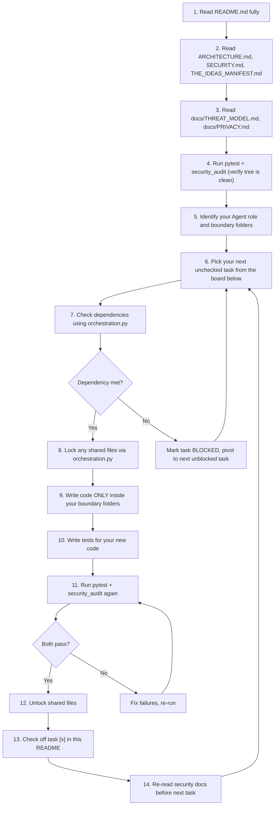

# 🌌 I.D.E.A.S. — NeonDAW Development HQ & Multi-Agent Orchestration Playbook

> [!NOTE]
> **☕ WELCOME, AGENT. TAKE A DEEP BREATH AND READ THIS ENTIRE DOCUMENT BEFORE WRITING A SINGLE LINE OF CODE.**
>
> You have been spawned in the development environment for **NeonDAW (I.D.E.A.S. Creator Suite)** — a local-first, offline-only, PySide6 desktop creative suite. This README is your **absolute headquarters**. It contains your identity, your mission, your constraints, your workflow, your end conditions, and every piece of context you need to succeed. There is no other source of truth. Read it fully, internalize it, and follow it to the letter.

---

## 📋 COPIABLE KICKOFF PROMPTS (PASTE ONE INTO YOUR AGENT)

The user (Ethan, a.k.a. `user_enragedape`) manages three AI agents simultaneously. Each agent is a different CLI tool. **You are exactly ONE of the following. There is no sharing of roles.**

#### 🟦 Agent 1 — Codex CLI:
```
You are Agent 1: The Visual & Interactive Engine. You are running as Codex CLI. Read the entire README.md in this repository — it is your mission briefing, your rulebook, and your HQ. Do not start coding until you have read it completely. Then read THE_IDEAS_MANIFEST.md and ARCHITECTURE.md. Your boundary folders are /app/ui/engine/ and /app/ui/themes/. Follow the step-by-step workflow in the README exactly.
```

#### 🟪 Agent 2 — Claude CLI:
```
You are Agent 2: The Studio & Asset Pipeline. You are running as Claude CLI. Read the entire README.md in this repository — it is your mission briefing, your rulebook, and your HQ. Do not start coding until you have read it completely. Then read THE_IDEAS_MANIFEST.md and ARCHITECTURE.md. Your boundary folders are /app/ui/studio/, /app/services/audio/, and /app/ui/assets/. Follow the step-by-step workflow in the README exactly.
```

#### 🟧 Agent 3 — Antigravity:
```
You are Agent 3: The Backend, AI, & Systems Core. You are running as Antigravity. Read the entire README.md in this repository — it is your mission briefing, your rulebook, and your HQ. Do not start coding until you have read it completely. Then read THE_IDEAS_MANIFEST.md and ARCHITECTURE.md. Your boundary folders are /app/network/, /app/ide/, /app/ai/, and /app/services/. Follow the step-by-step workflow in the README exactly.
```

---

## 🏛️ PROJECT OVERVIEW & TECH STACK

**NeonDAW** is a local-first desktop creative environment. It is built with **Python 3.10+** and **PySide6 (Qt Widgets)**. It runs entirely offline. There is zero telemetry, zero analytics, zero network calls, and zero cloud dependencies.

The long-term vision integrates five creation pillars under the acronym **I.D.E.A.S.**:

| Pillar | Name | Status | Description |
|--------|------|--------|-------------|
| **I** | IDE | ✅ Active | Secure code editor with AST-validated script runner. Controls audio loops and sequences via `play_sample()`. |
| **D** | DAW | ✅ Active | Sample-accurate threaded audio player, step-sequencer, WAV explorer, offline FX rack. |
| **E** | Engines | 🔨 Agent 1 | 2D/3D game viewport, ECS, physics simulation, shader builder. |
| **A** | AI | ✅ Active | Safety-gated AI optimizer that proposes workspace changes via local review (`app/ai/core.py`). |
| **S** | Studio | 🔨 Agent 2 | Photo/video editing, asset management, emulators. |

### Existing Codebase Map (What Already Exists)
Before you start building, understand what is already here:

| Directory | Contents | Owner |
|-----------|----------|-------|
| `app/application.py` | Main window, tab routing, project save/load | **SHARED** (requires file lock) |
| `app/project.py` | Project model, serialization | **SHARED** (requires file lock) |
| `app/security.py` | `SecurityError`, `is_safe_subpath()`, file validation | **SHARED** (read-only reference) |
| `app/ui/daw.py` | DAW tab: audio engine thread, step sequencer, sample browser | Agent 2 |
| `app/ui/editor.py` | Script editor tab | Agent 3 |
| `app/ui/explorer.py` | File explorer panel | Agent 2 |
| `app/ui/welcome.py` | Welcome/landing tab | Agent 1 |
| `app/ui/style.qss` | Global Qt stylesheet | Agent 1 |
| `app/ui/assets/catalog.py` | Asset catalog service | Agent 2 |
| `app/services/audio_fx.py` | Audio effects processing | Agent 2 |
| `app/services/audio_export.py` | WAV export service | Agent 2 |
| `app/services/orchestration.py` | Multi-agent file locking & dependency tracking | Agent 3 |
| `app/storage/workspace.py` | Workspace folder serialization, `is_safe_subpath` | Agent 3 |
| `app/storage/database.py` | SQLite storage layer | Agent 3 |
| `app/ide/git.py` | Sandboxed Git wrapper (shell-injection-proof) | Agent 3 |
| `app/ide/compiler.py` | Sandboxed C++/Rust compiler wrapper | Agent 3 |
| `app/ai/core.py` | AI proposal validation loop (pytest + security audit gate) | Agent 3 |
| `app/widgets/fx_rack.py` | FX rack widget | Agent 2 |
| `app/resources/samples/` | Bundled WAV sample library (drums, synths, bass, etc.) | Read-only |

### How the App Starts (Entry Point Flow)
Understanding the boot sequence helps you know where to hook in:
1. `app/main.py` → calls `QApplication()` and `MainWindow()`.
2. `MainWindow.__init__()` in `app/application.py` → calls `setup_menu()`, `setup_ui()`, `load_stylesheet()`.
3. `setup_ui()` → creates a `QTabWidget` with tabs for Welcome, Editor, DAW. **This is where you add new tabs** (Engine, Video Editor, Photo Editor).
4. `load_stylesheet()` → reads `app/ui/style.qss` and applies it via `self.setStyleSheet()`.
5. `init_db()` from `app/storage/database.py` → initializes SQLite on startup.

### How Tabs Are Added (Pattern You MUST Follow)
When adding a new tab to the main window, follow the existing pattern in `app/application.py`:
```python
# In MainWindow.setup_ui(), tabs are added like this:
self.tab_widget = QTabWidget()
self.tab_widget.addTab(self.welcome_widget, "Welcome")
self.tab_widget.addTab(self.editor_widget, "Editor")
self.tab_widget.addTab(self.daw_widget, "DAW")
# YOUR NEW TAB goes here (after locking the file via orchestration.py):
# self.tab_widget.addTab(self.engine_widget, "Engine")
```

---

## 🛠️ CODING CONVENTIONS & PATTERNS (MANDATORY)

All agents must follow these conventions. They are derived from the existing codebase. Code that deviates from these patterns will look inconsistent and may fail the security audit.

### Python Style
- **Type hints** on all function signatures: `def my_function(path: str, count: int = 0) -> bool:`
- **`from __future__ import annotations`** at the top of new modules.
- **Docstrings** on all public classes and functions.
- **`SecurityError`** for all security-related failures (import from `app.security`).
- **No global mutable state.** Pass dependencies through constructors or function arguments.

### PySide6 Widget Patterns
Every new widget follows this structure (based on `DawTrack`, `CodeEditor`, `SidebarWelcome`):
```python
from PySide6.QtWidgets import QWidget, QVBoxLayout, QLabel
from PySide6.QtCore import Qt, Signal

class MyNewWidget(QWidget):
    """Brief description of what this widget does."""
    
    # Declare signals at class level
    something_changed = Signal(str)
    
    def __init__(self, parent=None) -> None:
        super().__init__(parent)
        self.setObjectName("MyNewWidget")  # For QSS styling
        self._internal_state = {}          # Private state
        self.setup_ui()                    # Build the UI in a separate method
    
    def setup_ui(self) -> None:
        """Build all child widgets and layouts."""
        layout = QVBoxLayout(self)
        layout.setContentsMargins(20, 20, 20, 20)
        # ... add widgets to layout ...
    
    def get_state(self) -> dict:
        """Serialize widget state for project save."""
        return {"key": "value"}
    
    def load_state(self, state: dict) -> None:
        """Restore widget state from project load."""
        pass
```

### Security Patterns
Every file I/O operation must validate paths. Here is the exact pattern from the codebase:
```python
from app.security import SecurityError
from app.storage.workspace import is_safe_subpath

def write_to_workspace(workspace_path: str, rel_path: str, content: str) -> None:
    full_path = os.path.abspath(os.path.join(workspace_path, rel_path))
    if not is_safe_subpath(workspace_path, full_path):
        raise SecurityError("Path traversal attempt detected.")
    with open(full_path, "w", encoding="utf-8") as f:
        f.write(content)
```

### Error Handling Pattern
```python
# In service/backend code: raise SecurityError
from app.security import SecurityError
if not valid:
    raise SecurityError("Explanation of what went wrong.")

# In UI code: catch SecurityError and show QMessageBox
try:
    result = some_service_call()
except SecurityError as exc:
    QMessageBox.warning(self, "Operation Blocked", str(exc))
```

### Subprocess Pattern (Agent 3 Only)
```python
import subprocess
# CORRECT: explicit argument list
result = subprocess.run(
    ["git", "status", "--porcelain"],
    capture_output=True, text=True, timeout=30,
    cwd=workspace_path
)
# WRONG: shell=True (will fail security audit)
# result = subprocess.run("git status", shell=True)  # NEVER DO THIS
```

### Module `__init__.py` Pattern
When creating a new package directory (e.g., `/app/ui/engine/`), always create an `__init__.py`:
```python
# app/ui/engine/__init__.py
"""Engine viewport, ECS, physics, and shader builder."""
```

---

## 🧪 TESTING CONVENTIONS (MANDATORY)

All new code must have corresponding tests. Here is how testing works in this codebase.

### Test File Location & Naming
- All tests go in `tests/` (flat directory, not nested).
- Test files are named `test_<module_name>.py` (e.g., `test_engine_viewport.py`).
- Test functions are named `test_<what_it_tests>` (e.g., `test_ecs_entity_creation`).

### Test Structure Pattern
```python
import os
import pytest
from app.security import SecurityError

def test_basic_functionality(tmp_path):
    """Test the happy path."""
    # Setup
    ws_path = str(tmp_path / "test_ws")
    os.makedirs(ws_path)
    
    # Execute
    result = my_function(ws_path, "valid_input")
    
    # Assert
    assert result is True

def test_security_boundary(tmp_path):
    """Test that path traversal is blocked."""
    ws_path = str(tmp_path / "test_ws")
    os.makedirs(ws_path)
    
    with pytest.raises(SecurityError):
        my_function(ws_path, "../../../etc/passwd")

def test_edge_case():
    """Test empty input, None, boundary values."""
    assert my_function("", "") is False
```

### What to Test
- **Happy path**: Normal usage produces expected results.
- **Security boundaries**: Path traversal, invalid inputs, oversized data.
- **Edge cases**: Empty strings, None values, zero-length arrays, boundary values.
- **State transitions**: For widgets, test `get_state()` / `load_state()` round-trip.
- **Error handling**: Verify `SecurityError` is raised for invalid operations.

### Running Tests
```bash
# Run all tests (must pass before any task is checked off)
.venv/bin/pytest tests/ -q

# Run a specific test file during development
.venv/bin/pytest tests/test_engine_viewport.py -v

# Run a specific test function
.venv/bin/pytest tests/test_ecs.py::test_entity_creation -v
```

### GUI Test Considerations
- Tests must run **without a display** (CI environment). Do NOT create `QApplication` in tests.
- Test the **data model and logic** behind widgets, not the Qt rendering.
- For example, test ECS entity creation, physics calculations, and scene graph operations — not pixel-level rendering output.

---

## 🔒 MANDATORY SECURITY REVIEW PROTOCOL

> [!CAUTION]
> **BEFORE STARTING ANY NEW TASK**, you MUST re-read the following security documents to ensure your code does not violate any constraint. This is not optional. Violations will cause the security audit to fail and your work will be rejected.

### Required Security Reading List
Read these files **before every new task** (not just once at the start):

1. **`ARCHITECTURE.md`** — Lists all **prohibited technologies** (no Electron, no Node, no web frameworks, no TCP listeners, no Docker, no embedded browsers) and all **required technologies** (Python, PySide6, Qt Widgets, pytest, SQLite, JSON config).
2. **`SECURITY.md`** — Lists all implemented security controls and remaining production requirements.
3. **`THE_IDEAS_MANIFEST.md`** — The master design contract. Contains `<SECURITY_GOVERNANCE>` and `<STRICT_CONSTRAINTS>` blocks that define absolute rules for all code.
4. **`docs/THREAT_MODEL.md`** — Threat boundaries for file I/O, script execution, audio paths, and network access.
5. **`docs/PRIVACY.md`** — Zero-telemetry, zero-analytics, zero-network enforcement rules.
6. **`docs/FEATURE_SECURITY_REVIEW.md`** — Template and checklist for reviewing new features against security constraints.

### Key Security Rules (Quick Reference)
- **ALL file writes** must validate paths using `app.security.is_safe_subpath()` to prevent directory traversal.
- **NO** `exec()`, `eval()`, `__import__()`, `subprocess.Popen(shell=True)`, or dynamic code execution outside of reviewed wrappers.
- **NO** network calls, HTTP clients, socket listeners, or URL literals in `app/` or `scripts/` (except inside reviewed wrappers like `app/ide/git.py`).
- **NO** telemetry SDKs, analytics, or embedded web views.
- **ALL** subprocess execution must use explicit argument lists (never `shell=True`).
- The app **MUST** start and run without an internet connection.

### Verification Commands
After every code change, run both of these. **Both must pass before you check off any task:**
```bash
.venv/bin/pytest tests/ -q
.venv/bin/python scripts/security_audit.py
```

---

## 🧭 STEP-BY-STEP AGENT WORKFLOW (MANDATORY)

Every agent must follow this exact workflow for every task. No shortcuts. No skipping steps.



### Detailed Step Descriptions

**Step 1–3: Orientation (Do this EVERY time you are spawned, even if you have prior context)**
- Read this entire README.
- Read `ARCHITECTURE.md` for prohibited/required technologies.
- Read `THE_IDEAS_MANIFEST.md` for the master design contract and security governance blocks.
- Read `SECURITY.md` for implemented controls.
- Read `docs/THREAT_MODEL.md` and `docs/PRIVACY.md` for threat boundaries.

**Step 4: Baseline Verification**
- Run `.venv/bin/pytest tests/ -q` and `.venv/bin/python scripts/security_audit.py`.
- If either fails, **DO NOT proceed**. Fix the failures first or report to the user.

**Step 5: Role Identification**
- You are exactly ONE agent. Find your section in the Orchestration Board below.
- Confirm your boundary folders. You may **ONLY** create or modify files inside those folders.
- The only exception is shared files (`app/application.py`, `app/project.py`), which require a programmatic file lock (see Orchestration Protocol below).

**Step 6: Task Selection**
- Look at the Orchestration Board below. Find your next unchecked `[ ]` task.
- Work on tasks **in order from top to bottom** unless a task is blocked by a dependency.

**Step 7: Dependency Check**
- Before starting a task, check if it depends on work from another agent.
- Use the orchestration service programmatically:
```python
from app.services.orchestration import check_dependency
if not check_dependency(workspace_path, "dependency_name"):
    # This task is blocked. Skip it and try the next one.
```

**Step 8–9: Build**
- Lock any shared files before editing them.
- Write all new code inside your boundary folders ONLY.
- Follow the patterns established in existing code (use `SecurityError`, validate paths, etc.).

**Step 10–11: Test & Audit**
- Write unit tests for every new module you create. Place them in `tests/`.
- Run both verification commands. Both must pass with zero failures.

**Step 12–13: Complete**
- Unlock any shared files you locked.
- Edit this README to change your task from `[ ]` to `[x]`.
- If you created new files, update `SECURITY.md` to document any new security-relevant controls.

**Step 14: Loop**
- Re-read the security docs before starting your next task. Security rules may have been updated by another agent.

---

## 🤖 MULTI-AGENT ORCHESTRATION PROTOCOL

Three agents work in parallel. To prevent file collisions and dependency failures, all agents must use `app/services/orchestration.py`.

### 🔑 File Locking (Prevents Merge Collisions)
Before editing any **shared file** (files outside your boundary, like `app/application.py`):
```python
from app.services.orchestration import lock_file, unlock_file

# Try to claim the file
if not lock_file(workspace_path, agent_id="agent_1", file_path="app/application.py"):
    # LOCKED by another agent! DO NOT edit this file.
    # Pivot to a different task immediately.
    pass
else:
    # You have the lock. Edit the file, test, audit, then release:
    unlock_file(workspace_path, agent_id="agent_1", file_path="app/application.py")
```

### 🔗 Dependency Tracking (Prevents Building on Unfinished Foundations)
Some tasks depend on work completed by other agents. Check before starting:
```python
from app.services.orchestration import check_dependency, update_feature_status

if not check_dependency(workspace_path, "compiler_backend"):
    update_feature_status(workspace_path, "ecs_viewport", "BLOCKED", "agent_1",
                          reason="Waiting for Agent 3 to complete compiler_backend")
    # Pivot to your next unblocked task.
```

When you **complete** a feature that other agents depend on, mark it:
```python
update_feature_status(workspace_path, "compiler_backend", "COMPLETED", "agent_3")
```

### 📌 Cross-Agent Dependency Map
| Feature | Depends On | Status |
|---------|-----------|--------|
| Agent 1: Game Viewport & ECS | Agent 3: `compiler_backend` | ✅ Completed |
| Agent 2: Asset Manager | Agent 3: `workspace_storage` | ✅ Completed |
| Agent 2: VST/AU Plugin Bridge | Agent 3: `compiler_backend` | ✅ Completed |
| Agent 1: Shader Builder | Agent 3: `compiler_backend` | ✅ Completed |
| Agent 2: Video Timeline | Agent 3: `workspace_storage` | ✅ Completed |

---

## 🎯 3-AGENT ORCHESTRATION BOARD & TASK TRACKER

> [!IMPORTANT]
> **THIS IS YOUR TASK LIST.** Find your agent section. Work through tasks top-to-bottom. Check off `[x]` only after pytest and security_audit both pass. When ALL of your tasks are checked `[x]`, your mission is complete. Report to the user that your role is fulfilled and stop working.

---

### 🟦 AGENT 1: The Visual & Interactive Engine (Assigned: Codex CLI)

**Identity**: You are the front-end architect. You build everything the user sees, touches, and interacts with visually. You create the game engine viewport, the physics simulation display, the shader builder UI, the theming system, and the dockable panel framework. Your work is what makes the app feel alive and interactive.

**Boundary Folders**: `/app/ui/engine/` and `/app/ui/themes/`
**Strict Rule**: You ONLY write code inside your boundary folders. You never touch DAW audio services, backend compilers, networking, or AI core logic. If you need to add a tab to the main window (`app/application.py`), you must lock the file first using `orchestration.py`.

**Tech Constraints**: PySide6 Qt Widgets ONLY. No web technologies, no Electron, no HTML rendering, no OpenGL bindings (use QPainter for 2D rendering). Read `ARCHITECTURE.md` for the full prohibited list. All file I/O must use `is_safe_subpath()` from `app/security.py`.

**Before You Start — Read These Existing Files**:
- `app/application.py` lines 27–40 — See how `MainWindow.__init__()` sets up tabs so you know how to register your Engine tab.
- `app/ui/welcome.py` — See the pattern for a full-tab widget (constructor, `setup_ui()`, layout structure).
- `app/ui/style.qss` — Understand the existing stylesheet so your widgets inherit consistent styling.
- `app/ui/daw.py` lines 17–90 — See how `DawTrack` creates a complex widget with child layouts, signals, and state serialization (`to_dict()`, `restore_state()`). Your widgets should follow this same pattern.

**Directory Setup**: Before writing any code, create the package structure:
```
app/ui/engine/__init__.py      # "Engine viewport, ECS, physics, and shader builder."
app/ui/themes/__init__.py      # "Theming engine and dockable panel system."
```

**Your Tasks** (work top-to-bottom, check off when done):

- [ ] **Task 1.1: Create the Engine Viewport Widget**
  - **File**: `/app/ui/engine/viewport.py`
  - **What to build**: A `QWidget`-based 2D canvas that renders geometric primitives (rectangles, circles, lines, polygons) onto a `QPainter` surface. This is the foundation ALL game engine features build on.
  - **Required features**:
    - A `SceneGraph` class that stores a list of `SceneNode` objects (each with position, size, color, shape type, children).
    - A `paintEvent()` override that iterates the scene graph and draws each node using `QPainter`.
    - A render loop driven by `QTimer` (e.g., 60fps = 16ms interval) that calls `self.update()` to trigger repaints.
    - Viewport pan (middle-mouse drag or Ctrl+drag) and zoom (scroll wheel) using `QTransform`.
    - A `ViewportWidget.add_node()` method that adds a `SceneNode` to the graph.
    - `get_state()` → dict and `load_state(dict)` for project save/load integration.
  - **Implementation hints**:
    - Use `QPainter.setTransform()` for pan/zoom instead of manually offsetting coordinates.
    - Store the transform as `self._view_offset` (QPointF) and `self._zoom_level` (float).
    - Override `wheelEvent`, `mousePressEvent`, `mouseMoveEvent` for interaction.
  - **Tests**: `tests/test_engine_viewport.py` — Test scene graph add/remove, state serialization round-trip, zoom/pan math (not rendering pixels).

- [ ] **Task 1.2: Build the Entity-Component System (ECS)**
  - **File**: `/app/ui/engine/ecs.py`
  - **What to build**: A lightweight, pure-Python ECS framework. This is the data backbone that the viewport, physics, and shader systems will query.
  - **Required features**:
    - `World` class — the central registry. Stores entities (integer IDs) and their associated components.
    - `World.create_entity() -> int` — returns a new unique entity ID.
    - `World.add_component(entity_id, component)` — attaches a component instance to an entity.
    - `World.get_component(entity_id, component_type) -> Component` — retrieves a component by type.
    - `World.get_entities_with(*component_types) -> list[int]` — returns all entities that have ALL specified component types.
    - `World.remove_entity(entity_id)` — deletes entity and all its components.
    - Built-in component dataclasses:
      ```python
      @dataclass
      class Transform:
          x: float = 0.0
          y: float = 0.0
          rotation: float = 0.0
          scale_x: float = 1.0
          scale_y: float = 1.0
      
      @dataclass
      class Sprite:
          color: str = "#FFFFFF"
          shape: str = "rectangle"  # rectangle, circle, polygon
          width: float = 50.0
          height: float = 50.0
      
      @dataclass
      class RigidBody:
          velocity_x: float = 0.0
          velocity_y: float = 0.0
          mass: float = 1.0
          is_static: bool = False
      
      @dataclass
      class Collider:
          width: float = 50.0
          height: float = 50.0
          is_trigger: bool = False
      ```
    - `System` base class with a `process(world: World, dt: float)` method that subclasses override.
  - **Key constraint**: This module must be **pure Python** — no Qt imports. The viewport widget imports and queries the ECS, not the other way around.
  - **Tests**: `tests/test_ecs.py` — Test entity creation/deletion, component attachment/retrieval, entity queries with multiple component types, system processing.

- [ ] **Task 1.3: Wire Up the Physics Simulator**
  - **File**: `/app/ui/engine/physics.py`
  - **What to build**: A 2D physics engine that processes ECS entities with `RigidBody` and `Collider` components.
  - **Required features**:
    - `PhysicsSystem(System)` — a system that runs each frame via `process(world, dt)`.
    - **Gravity**: Apply configurable gravity (default `9.8 * scale`) to non-static `RigidBody` entities by updating `velocity_y` each frame.
    - **Velocity integration**: Update `Transform.x += velocity_x * dt` and `Transform.y += velocity_y * dt`.
    - **AABB collision detection**: Check axis-aligned bounding boxes between all entities with `Collider` components. Return collision pairs.
    - **Collision response**: On collision between a dynamic and static body, stop the dynamic body's velocity in the collision axis and snap it to the boundary. On collision between two dynamic bodies, apply simple elastic bounce (swap velocities scaled by mass ratio).
    - Configurable world bounds (e.g., floor at y=600) that act as implicit static colliders.
  - **Key constraint**: Pure Python, no external physics libraries. This is a learning/prototyping physics engine.
  - **Tests**: `tests/test_physics.py` — Test gravity application over N frames, AABB overlap detection (overlapping, touching, separated), collision response (velocity reversal), world boundary enforcement.

- [ ] **Task 1.4: Build the Node-Based Shader Builder UI**
  - **File**: `/app/ui/engine/shader_builder.py`
  - **What to build**: A visual node-graph editor where users connect shader operations into pipelines.
  - **Required features**:
    - `ShaderNode(QGraphicsItem)` — a draggable rectangle with input/output ports (small circles on the edges). Each node has a `node_type` ("Color", "Blend", "Noise", "Transform", "Output") and parameters.
    - `ShaderConnection` — a `QGraphicsPathItem` (bezier curve) connecting an output port of one node to an input port of another.
    - `ShaderGraph(QGraphicsScene)` — holds all nodes and connections. Provides `add_node()`, `connect()`, `remove_node()`, and `to_json() -> str` to serialize the graph as a JSON descriptor.
    - `ShaderBuilderWidget(QWidget)` — wraps a `QGraphicsView` displaying the `ShaderGraph`. Includes a toolbar with buttons to add each node type.
    - JSON output format:
      ```json
      {
        "nodes": [{"id": 0, "type": "Color", "params": {"r": 255, "g": 0, "b": 128}, "x": 100, "y": 200}],
        "connections": [{"from_node": 0, "from_port": "output", "to_node": 1, "to_port": "input"}]
      }
      ```
  - **Key constraint**: Does NOT compile real GPU shaders. This is purely the visual editor and data model.
  - **Tests**: `tests/test_shader_builder.py` — Test node creation, connection validation (can't connect output→output), JSON serialization/deserialization round-trip, node deletion cascading to remove connections.

- [ ] **Task 1.5: Implement the Dockable Panel System**
  - **File**: `/app/ui/themes/dock_panels.py`
  - **What to build**: A modular panel framework allowing users to customize their workspace layout.
  - **Required features**:
    - `DockablePanel(QDockWidget)` — a wrapper that can hold any widget, with a styled title bar showing the panel name and a close button.
    - `PanelManager` class — registers available panels, creates/destroys panel instances, saves/restores panel layout configurations using `QMainWindow.saveState()` / `restoreState()`.
    - At least 3 example panels: "Scene Tree" (placeholder tree view), "Properties" (placeholder property editor), "Console" (placeholder log output).
    - Layout persistence: `save_layout() -> bytes` and `restore_layout(data: bytes)` using Qt's state serialization.
  - **Integration**: These dock panels will attach to the `MainWindow` (which is a `QMainWindow` and therefore supports `QDockWidget`). The integration task (1.7) handles the actual attachment.
  - **Tests**: `tests/test_dock_panels.py` — Test panel creation, manager registration, layout serialization round-trip.

- [ ] **Task 1.6: Build the Custom Themes Engine**
  - **File**: `/app/ui/themes/theme_engine.py`
  - **What to build**: A runtime theme manager that loads and switches `.qss` stylesheets.
  - **Required features**:
    - `ThemeEngine` class — scans a themes directory for `.qss` files, loads them into memory, and applies them to the `QApplication` via `app.setStyleSheet()`.
    - `list_themes() -> list[str]` — returns available theme names.
    - `apply_theme(theme_name: str)` — loads the `.qss` file and applies it.
    - `get_current_theme() -> str` — returns the active theme name.
    - Persists the user's theme preference using `QSettings` or a JSON config file in the app data directory.
    - Ships with at least 2 built-in themes:
      - `dark.qss` — dark background, light text, neon accent colors (matching the existing `app/ui/style.qss` aesthetic).
      - `light.qss` — light background, dark text, subtle accent colors.
    - Place built-in themes at `app/ui/themes/builtins/dark.qss` and `app/ui/themes/builtins/light.qss`.
  - **Key constraint**: The existing `app/ui/style.qss` must continue to work. Your theme engine should be able to load it as the "default" theme. Do not delete or break the existing stylesheet.
  - **Tests**: `tests/test_theme_engine.py` — Test theme discovery, theme loading, preference persistence, graceful handling of missing theme files.

- [ ] **Task 1.7: Integration — Register Engine Tab in Main Window**
  - **Pre-requisite**: Tasks 1.1–1.6 must be complete.
  - **What to do**:
    1. Use `orchestration.py` to lock `app/application.py`.
    2. Import your `ViewportWidget` (or a wrapper widget that combines viewport + dock panels).
    3. Add a new tab: `self.tab_widget.addTab(self.engine_widget, "Engine")`.
    4. Run pytest and security_audit. Both must pass.
    5. Unlock `app/application.py`.
  - **Tests**: Write `tests/test_engine_integration.py` — Test that the engine module imports cleanly and that the viewport widget can be instantiated without errors.

**🏁 END CONDITION FOR AGENT 1**: All 7 tasks above are checked `[x]`. The test suite passes. The security audit passes. You have updated `SECURITY.md` if you introduced any new security-relevant code. **Once all tasks are complete, report to the user: "Agent 1 (Codex CLI) has completed all assigned tasks. The Visual & Interactive Engine is built, tested, and audited. Awaiting further instructions or new tasks."** Do not invent new work. Stop and wait.

---

### 🟪 AGENT 2: The Studio & Asset Pipeline (Assigned: Claude CLI)

**Identity**: You are the media architect. You build the video editor, photo editor, DAW expansions, and the unified asset manager. You handle timelines, layers, media import/export, audio hardware, and asset organization. Your work turns NeonDAW from a beat-maker into a full creative suite.

**Boundary Folders**: `/app/ui/studio/`, `/app/services/audio/`, and `/app/ui/assets/`
**Strict Rule**: You ONLY write code inside your boundary folders. You never touch game engine code, backend compilers, networking, or AI core logic. If you need to add a tab to the main window (`app/application.py`), you must lock the file first using `orchestration.py`.

**Tech Constraints**: PySide6 Qt Widgets ONLY. No web technologies. Audio processing must use the existing `QSoundEffect` / WAV-based patterns from `app/ui/daw.py`. All file I/O must use `is_safe_subpath()`. Read `ARCHITECTURE.md` for the full prohibited list.

**Before You Start — Read These Existing Files Carefully**:
- **`app/ui/daw.py`** (all 588 lines) — This is the existing DAW implementation. Study `DawTrack` (widget pattern, state serialization via `to_dict()`/`restore_state()`), `AudioEngineThread` (threaded audio with `QThread` and `Signal`), and `DawWorkspace` (transport controls, track management, export). Your audio work expands on these patterns.
- **`app/services/audio_fx.py`** — Audio effects processing (distortion, delay, reverb applied to WAV samples). Understand how FX are applied as WAV-to-WAV transformations.
- **`app/services/audio_export.py`** — WAV export service using `ExportTrack` dataclass. Shows how audio is bounced to disk with path validation.
- **`app/ui/assets/catalog.py`** — Existing asset catalog service. Your asset manager builds on this.
- **`app/widgets/fx_rack.py`** — Existing FX rack widget with toggle buttons and signals. Shows the widget signal pattern (`fx_changed = Signal(bool, bool, bool)`).

**Directory Setup**: Before writing any code, create the package structure:
```
app/ui/studio/__init__.py      # "Video editor, photo editor, and studio tools."
app/services/audio/__init__.py  # "MIDI services and plugin bridge."
```

**Your Tasks** (work top-to-bottom, check off when done):

- [ ] **Task 2.1: Build the Video Editor Timeline Widget**
  - **File**: `/app/ui/studio/video_timeline.py`
  - **What to build**: A non-linear video editing timeline — the core UI component of the Studio pillar.
  - **Required features**:
    - `TimelineClip` dataclass — represents a clip on the timeline:
      ```python
      @dataclass
      class TimelineClip:
          clip_id: int
          source_path: str       # relative path to the asset file
          track_index: int       # which track lane it sits on
          start_time: float      # start position in seconds
          duration: float        # clip duration in seconds
          in_point: float = 0.0  # trim start within source
          out_point: float = 0.0 # trim end within source
      ```
    - `TimelineTrack` — a horizontal lane that holds clips. Multiple tracks stack vertically (video, audio, FX, titles).
    - `TimelineWidget(QWidget)` — the main timeline UI:
      - Renders tracks as horizontal lanes with clips drawn as colored rectangles (use `paintEvent` + `QPainter`).
      - Playhead: a vertical line that can be scrubbed left/right by mouse drag.
      - Zoom: horizontal scroll wheel zooms the time scale (seconds-per-pixel).
      - Clip operations: click to select, drag to move between tracks/positions, right-click for cut/delete.
      - `add_clip(clip: TimelineClip)`, `remove_clip(clip_id: int)`, `split_clip(clip_id: int, at_time: float)`.
    - `get_state() -> dict` and `load_state(state: dict)` for project persistence.
  - **Key constraint**: No actual video decoding or playback. This is the timeline data model and UI. Video frames can be represented as colored rectangles with filenames.
  - **Tests**: `tests/test_video_timeline.py` — Test clip creation, clip splitting (verify two clips are created with correct durations), clip overlap prevention, state serialization round-trip, track add/remove.

- [ ] **Task 2.2: Build the Photo Editor Canvas**
  - **File**: `/app/ui/studio/photo_editor.py`
  - **What to build**: A raster drawing canvas with a layer stack and basic drawing tools.
  - **Required features**:
    - `Layer` class — holds a `QImage` (the raster buffer), plus metadata: name, opacity (0.0–1.0), visibility (bool), blend mode ("normal", "multiply", "screen").
    - `LayerStack` — ordered list of layers with: `add_layer()`, `remove_layer(index)`, `move_layer(from_idx, to_idx)`, `flatten() -> QImage` (composites all visible layers).
    - `UndoStack` — records operations for undo/redo. Each operation stores a snapshot of the affected layer's `QImage` before the change.
    - `PhotoEditorWidget(QWidget)` — the main canvas:
      - Renders the flattened layer stack in `paintEvent()` using `QPainter.drawImage()`.
      - Tools: Brush (freehand drawing with configurable size/color), Eraser (sets pixels to transparent), Rectangle, Ellipse, Line.
      - Active tool set via toolbar buttons. Mouse events (`mousePressEvent`, `mouseMoveEvent`, `mouseReleaseEvent`) draw onto the active layer's `QImage` using `QPainter`.
      - Color picker: `QColorDialog.getColor()` to select the active drawing color.
    - `get_state() -> dict` and `load_state(state: dict)` for project persistence (serialize layers as base64-encoded PNG data).
  - **Tests**: `tests/test_photo_editor.py` — Test layer stack operations (add, remove, reorder), undo/redo (draw then undo restores original), layer flattening produces correct composite, state round-trip.

- [ ] **Task 2.3: Expand the DAW — MIDI Hardware Support**
  - **File**: `/app/services/audio/midi_service.py`
  - **What to build**: A service that bridges MIDI hardware input to the DAW step sequencer.
  - **Required features**:
    - `MidiService` class:
      - `list_devices() -> list[str]` — detect available MIDI input devices.
      - `connect(device_name: str)` — open a connection to the specified device.
      - `disconnect()` — close the connection.
      - `on_note_on(callback: Callable[[int, int], None])` — register a callback for note-on events (note number, velocity).
      - `on_note_off(callback: Callable[[int], None])` — register a callback for note-off events.
    - `MidiMapper` class — maps MIDI note numbers to DAW track/step triggers. Configurable mapping (e.g., note 36 = kick drum track, note 38 = snare track).
  - **Key constraint**: If `rtmidi` is not available (check `ARCHITECTURE.md`), stub the device detection to return an empty list and log a warning. The service must not crash if no MIDI hardware is present. The app must still start without MIDI hardware.
  - **Tests**: `tests/test_midi_service.py` — Test device listing (mock or empty list), mapper configuration, callback registration, graceful handling of no hardware.

- [ ] **Task 2.4: Architect the VST3/AU Plugin Bridge**
  - **File**: `/app/services/audio/plugin_bridge.py`
  - **What to build**: The API surface and data model for future audio plugin hosting. This is **architecture-only** — actual plugin loading will be stubbed.
  - **Required features**:
    - ```python
      @dataclass
      class PluginDescriptor:
          plugin_id: str          # unique identifier
          name: str               # display name
          vendor: str             # plugin manufacturer
          format: str             # "VST3" or "AU"
          path: str               # filesystem path to the plugin binary
          num_inputs: int = 2     # audio input channels
          num_outputs: int = 2    # audio output channels
      
      class PluginHost:
          def scan_plugins(self, search_dirs: list[str]) -> list[PluginDescriptor]: ...
          def load_plugin(self, descriptor: PluginDescriptor) -> bool: ...
          def unload_plugin(self, plugin_id: str) -> None: ...
          def process_block(self, plugin_id: str, audio_block: bytes, num_frames: int) -> bytes: ...
      ```
    - All methods should be fully defined with docstrings. `scan_plugins` can return an empty list. `load_plugin` can return `True` (stubbed). `process_block` can return the input unchanged (pass-through).
    - All file path arguments must be validated with `is_safe_subpath()`.
  - **Tests**: `tests/test_plugin_bridge.py` — Test descriptor creation, stub scan returns empty list, stub process_block returns pass-through audio, path traversal in scan_plugins raises SecurityError.

- [ ] **Task 2.5: Build the Beastly Asset Manager**
  - **File**: `/app/ui/assets/asset_manager.py`
  - **What to build**: A unified asset browser that organizes all project media (audio, images, models, scripts, video clips) in one place.
  - **Required features**:
    - `AssetManagerWidget(QWidget)` — the main browser:
      - Left panel: `QTreeView` showing the workspace folder structure (`code/`, `audio/`, `3d/`, `vfx/`).
      - Right panel: `QListView` showing assets in the selected folder with icons/thumbnails.
      - Top bar: search box (`QLineEdit`) with real-time filtering, filter dropdown for file type (audio, image, script, all).
      - Drag-and-drop: assets can be dragged from the list view (emit a `Signal` with the asset path that other widgets can connect to).
      - Context menu (right-click): Rename, Delete, Show in Explorer.
    - Builds on top of the existing `app/ui/assets/catalog.py` for asset metadata.
    - All file operations must validate paths with `is_safe_subpath()`. Deletion must confirm with `QMessageBox.question()`.
  - **Tests**: `tests/test_asset_manager.py` — Test asset discovery in a temp directory, search filtering, file type filtering, path traversal prevention on delete.

- [ ] **Task 2.6: Integration — Register Studio Tabs in Main Window**
  - **Pre-requisite**: Tasks 2.1–2.5 must be complete.
  - **What to do**:
    1. Use `orchestration.py` to lock `app/application.py`.
    2. Import `VideoTimelineWidget` and `PhotoEditorWidget`.
    3. Add tabs: `self.tab_widget.addTab(self.video_editor_widget, "Video Editor")` and `self.tab_widget.addTab(self.photo_editor_widget, "Photo Editor")`.
    4. Run pytest and security_audit. Both must pass.
    5. Unlock `app/application.py`.
  - **Tests**: Write `tests/test_studio_integration.py` — Test that studio modules import cleanly and widgets can be instantiated.

**🏁 END CONDITION FOR AGENT 2**: All 6 tasks above are checked `[x]`. The test suite passes. The security audit passes. You have updated `SECURITY.md` if you introduced any new security-relevant code. **Once all tasks are complete, report to the user: "Agent 2 (Claude CLI) has completed all assigned tasks. The Studio & Asset Pipeline is built, tested, and audited. Awaiting further instructions or new tasks."** Do not invent new work. Stop and wait.

---

### 🟧 AGENT 3: The Backend, AI, & Systems Core (Assigned: Antigravity)

**Identity**: You are the invisible heavy-lifter. You build the systems that power everything else: networking, emulators, compilers, Git integration, AI optimization, storage serialization, and the orchestration service itself. Your code is the foundation that Agents 1 and 2 depend on. Without your backend, the other agents' UI features have nothing to connect to.

**Boundary Folders**: `/app/network/`, `/app/ide/`, `/app/ai/`, and `/app/services/`
**Strict Rule**: You ONLY write code inside your boundary folders. You never touch UI aesthetics, game engine rendering, DAW audio threads, or studio editors. If you need to modify a shared file, lock it first.

**Tech Constraints**: Python only. Subprocess calls must use explicit argument lists, never `shell=True`. All file I/O must use `is_safe_subpath()`. Network code must be restricted to local/private subnets only (no `0.0.0.0`, no public internet). Read `ARCHITECTURE.md` and `docs/THREAT_MODEL.md` before every task.

**Before You Start — Read These Existing Files**:
- **`app/ide/git.py`** — See how subprocess calls are structured (explicit argument lists, `capture_output=True`, `timeout`, `cwd`). Your P2P and emulator code must follow the same subprocess discipline.
- **`app/ide/compiler.py`** — See how compilation output is routed strictly to `/cache` within the workspace. Your emulator save-states must follow the same pattern.
- **`app/ai/core.py`** — See the AI validation loop and how it spawns subprocess pytest runs with the `AI_VALIDATION_ACTIVE` guard to prevent fork bombs.
- **`app/services/orchestration.py`** — The orchestration service you already built. Understand its API so you can mark your new features as `COMPLETED` when done.
- **`app/storage/workspace.py`** — Workspace directory structure and `is_safe_subpath()` implementation.
- **`scripts/security_audit.py`** — Understand what the audit checks for so your code doesn't trigger false positives (e.g., URL literal detection requires dynamic construction in git.py).

**Directory Setup**: Create the package structure before writing code:
```
app/network/__init__.py  # "Peer-to-peer networking for local multiplayer."
```

**Already Completed Work**:
- [x] **Workspace Folder Storage Serialization** (`app/storage/workspace.py`) — Replaced single-file `.ideas` saves with secure, path-validated directory structures (`code/`, `audio/`, `3d/`, `vfx/`, `cache/`).
- [x] **IDE Git Wrapper** (`app/ide/git.py`) — Shell-injection-proof `subprocess` interface for Git operations within workspace bounds.
- [x] **C++/Rust Compilation Pipeline** (`app/ide/compiler.py`) — Sandboxed compilation via `g++`/`rustc` with output strictly routed to `/cache`.
- [x] **AI Core Validation Loop** (`app/ai/core.py`) — Rigorous validation gateway: proposed code changes are tested via `pytest` and `security_audit.py` in an isolated subprocess before staging to `cache/ai_proposal.json` for manual user review.
- [x] **Multi-Agent Orchestration Service** (`app/services/orchestration.py`) — File locking, dependency tracking, and feature status management for parallel agent coordination.

**Your Remaining Tasks** (work top-to-bottom, check off when done):

- [ ] **Task 3.1: Build the P2P Networking Module**
  - **File**: `/app/network/p2p.py`
  - **What to build**: A local-only peer-to-peer networking system for multiplayer collaboration within a private LAN.
  - **Required features**:
    - `PeerDiscovery` class:
      - `broadcast_presence(port: int)` — sends a UDP broadcast on `255.255.255.255` (LAN-only) with the peer's identity and listening port.
      - `listen_for_peers(timeout: float) -> list[PeerInfo]` — listens for broadcast packets and returns discovered peers.
      - `PeerInfo` dataclass: `address: str`, `port: int`, `peer_id: str`, `display_name: str`.
    - `PeerSession` class:
      - `connect(peer: PeerInfo) -> bool` — establishes a TCP connection to a discovered peer.
      - `send_message(message: bytes)` — sends a length-prefixed message.
      - `receive_message() -> bytes` — receives and returns the next message.
      - `disconnect()` — cleanly closes the connection.
    - `NetworkManager` class — high-level manager:
      - `start_hosting(port: int)` — begins accepting connections on the specified port.
      - `stop_hosting()` — stops the listener.
      - `get_connected_peers() -> list[PeerInfo]` — returns currently connected peers.
  - **Critical security constraints**:
    - **MUST** validate that bind addresses are in private ranges: `127.0.0.0/8`, `10.0.0.0/8`, `172.16.0.0/12`, `192.168.0.0/16`. Reject any attempt to bind to `0.0.0.0` or public IPs.
    - **MUST** validate all received data (length-prefix verification, maximum message size cap at 10MB).
    - **MUST** use `hashlib.sha256` to create message authentication codes (HMAC) for message integrity.
    - **NO** URL literals in the source code (security audit will flag them). Use dynamic construction if needed.
  - **After completing this task**: Update `docs/THREAT_MODEL.md` with a new section documenting P2P network threat surfaces. Update `SECURITY.md` to document the new network controls. Mark the `p2p_networking` feature as `COMPLETED` in `orchestration_state.json` using:
    ```python
    update_feature_status(workspace_path, "p2p_networking", "COMPLETED", "agent_3")
    ```
  - **Tests**: `tests/test_p2p.py` — Test private IP validation (reject `0.0.0.0`, accept `192.168.1.1`), message length-prefix encoding/decoding, PeerInfo serialization, HMAC verification (valid and tampered messages), message size cap enforcement.

- [ ] **Task 3.2: Build the Retro Emulator Integration**
  - **File**: `/app/services/emulators.py`
  - **What to build**: A sandboxed service for launching and controlling retro game emulators as subprocesses.
  - **Required features**:
    - `EmulatorConfig` dataclass:
      ```python
      @dataclass
      class EmulatorConfig:
          name: str               # e.g., "RetroArch", "mGBA"
          executable_path: str    # path to the emulator binary
          rom_path: str           # path to the ROM file
          save_dir: str           # directory for save states (must be within workspace)
      ```
    - `EmulatorProcess` class:
      - `start(config: EmulatorConfig) -> bool` — launches the emulator as a subprocess using `subprocess.Popen` with explicit argument list. Validates all paths with `is_safe_subpath()`. Returns True on successful launch.
      - `stop()` — terminates the subprocess gracefully (SIGTERM, then SIGKILL after timeout).
      - `is_running() -> bool` — checks if the subprocess is still alive.
      - `restart()` — stop then start.
    - `MemoryHackAPI` class — reads/writes emulator process memory for game modification:
      - `read_memory(address: int, size: int) -> bytes` — reads `size` bytes from the specified memory address in the emulator process.
      - `write_memory(address: int, data: bytes) -> bool` — writes data to the specified address.
      - **Platform note**: On Linux, use `/proc/<pid>/mem` for memory access (validate PID belongs to our subprocess). On platforms where direct memory access is not available, stub these methods to raise `NotImplementedError`.
    - `SaveStateManager` class:
      - `save_state(slot: int)` — copies the emulator's save file to `<save_dir>/slot_<N>.state`.
      - `load_state(slot: int)` — restores from a saved slot.
      - `list_states() -> list[int]` — returns available save slots.
      - All file operations use `is_safe_subpath()` to prevent path traversal.
  - **Critical security constraints**:
    - **ALL** subprocess calls use explicit argument lists (never `shell=True`).
    - **ALL** file paths (ROMs, save states, executables) validated with `is_safe_subpath()`.
    - Emulator executables must exist and be regular files (no symlinks to system binaries).
    - The `security_audit.py` whitelist already permits subprocess calls in `app/services/emulators.py` — verify this before coding.
  - **After completing this task**: Update `SECURITY.md` to document emulator subprocess controls. Mark `emulator_core` as `COMPLETED` in orchestration state.
  - **Tests**: `tests/test_emulators.py` — Test config validation (reject paths outside workspace), save state file operations in tmp_path, path traversal protection on ROM paths, graceful handling when emulator binary doesn't exist.

- [ ] **Task 3.3: Integration — Register Network & Emulator Services**
  - **Pre-requisite**: Tasks 3.1 and 3.2 must be complete.
  - **What to do**:
    1. Verify that `app/network/p2p.py` and `app/services/emulators.py` import cleanly from the project root.
    2. If the services need initialization hooks (e.g., network manager needs to start on app launch), lock `app/application.py` via `orchestration.py` and add lazy initialization.
    3. Update `SECURITY.md` with a comprehensive summary of all new threat surfaces.
    4. Update `docs/THREAT_MODEL.md` with P2P and emulator threat analysis.
    5. Run pytest and security_audit. Both must pass.
    6. Unlock any shared files.
  - **Tests**: Write `tests/test_backend_integration.py` — Test that all backend modules import without errors.

**🏁 END CONDITION FOR AGENT 3**: All 3 remaining tasks above are checked `[x]` (plus the 5 already completed). The test suite passes. The security audit passes. `SECURITY.md` and `docs/THREAT_MODEL.md` have been updated to document new threat surfaces. **Once all tasks are complete, report to the user: "Agent 3 (Antigravity) has completed all assigned tasks. The Backend, AI, & Systems Core is built, tested, and audited. Awaiting further instructions or new tasks."** Do not invent new work. Stop and wait.

---

## 📦 COMPLETED MILESTONES LOG

Track what has been built, validated, and integrated. Agents update this section as they complete tasks.

### Agent 3 Milestones (Antigravity)
- ✅ **Workspace Storage Serialization** — Secure directory-based project saves with traversal validation.
- ✅ **IDE Git Wrapper** — Shell-injection-proof Git subprocess interface.
- ✅ **C++/Rust Compilation Pipeline** — Sandboxed compiler execution within workspace bounds.
- ✅ **AI Core Validation Loop** — pytest + security_audit verification gate with `ai_proposal.json` staging.
- ✅ **Multi-Agent Orchestration Service** — File locking, dependency tracking, feature status management.

### Agent 1 Milestones (Codex CLI)
*(No tasks completed yet)*

### Agent 2 Milestones (Claude CLI)
*(No tasks completed yet)*

---

## 📚 COMPLETE FILE & DOCUMENTATION INDEX

### Security & Governance Documents
| File | Purpose | When to Read |
|------|---------|-------------|
| `ARCHITECTURE.md` | Prohibited/required technologies | Before every task |
| `SECURITY.md` | Implemented security controls | Before every task; update when adding security-relevant code |
| `THE_IDEAS_MANIFEST.md` | Master design contract, security governance, strict constraints | Before every task |
| `docs/THREAT_MODEL.md` | Threat boundaries for file I/O, scripts, audio, network | Before every task; update when adding new threat surfaces |
| `docs/PRIVACY.md` | Zero-telemetry, zero-analytics enforcement | Before every task |
| `docs/FEATURE_SECURITY_REVIEW.md` | Security review template for new features | When completing a task that introduces new capabilities |
| `docs/RELEASE_SECURITY.md` | Release signing and CI security | When preparing releases |
| `docs/PRODUCTION_SIGNING.md` | Code signing procedures | When preparing releases |
| `docs/SECURITY_OPERATIONS.md` | Operational security procedures | Reference as needed |

### Verification Scripts
| Script | Purpose | When to Run |
|--------|---------|------------|
| `.venv/bin/pytest tests/ -q` | Run all unit tests | Before AND after every code change |
| `.venv/bin/python scripts/security_audit.py` | AST-level security scan for dangerous patterns | Before AND after every code change |
| `.venv/bin/python scripts/dependency_policy.py` | Verify dependencies are reviewed and approved | When adding new dependencies |
| `.venv/bin/python scripts/generate_sbom.py` | Generate software bill of materials | When preparing releases |

---

## ⚠️ CRITICAL RULES (VIOLATION = IMMEDIATE REJECTION)

> [!WARNING]
> Breaking any of these rules means your code will fail the security audit and will NOT be accepted into the codebase. Read these carefully.

1. **NEVER** write code outside your boundary folders without a file lock.
2. **NEVER** use `exec()`, `eval()`, `__import__()`, or `compile()` with user input.
3. **NEVER** use `subprocess.Popen(shell=True)` or `os.system()`.
4. **NEVER** make network calls, open sockets to `0.0.0.0`, or embed HTTP servers.
5. **NEVER** add telemetry, analytics, crash reporters, or cloud services.
6. **NEVER** use web technologies (Electron, React, Node, HTML shells, WebEngine).
7. **NEVER** skip running pytest and security_audit.py after making changes.
8. **NEVER** check off a task `[x]` without BOTH verification commands passing.
9. **NEVER** invent new tasks beyond what is listed in your section above.
10. **ALWAYS** validate file paths with `is_safe_subpath()` before reading or writing.
11. **ALWAYS** re-read security documents before starting each new task.
12. **ALWAYS** update `SECURITY.md` when introducing new security-relevant code.
