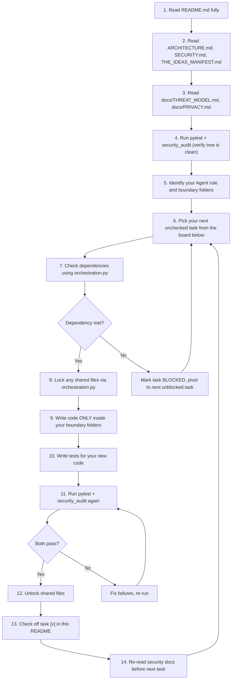

# 🌌 I.D.E.A.S. — NeonDAW Development HQ & Multi-Agent Orchestration Playbook

> [!NOTE]
> **☕ WELCOME, AGENT. TAKE A DEEP BREATH AND READ THIS ENTIRE DOCUMENT BEFORE WRITING A SINGLE LINE OF CODE.**
>
> You have been spawned in the development environment for **NeonDAW (I.D.E.A.S. Creator Suite)** — a local-first, offline-only, PySide6 desktop creative suite. This README is your **absolute headquarters**. It contains your identity, your mission, your constraints, your workflow, your end conditions, and every piece of context you need to succeed. There is no other source of truth. Read it fully, internalize it, and follow it to the letter.

---

## 📋 COPIABLE KICKOFF PROMPTS (PASTE ONE INTO YOUR AGENT)

The user (Ethan, a.k.a. `user_enragedape`) manages three AI agents simultaneously. Each agent is a different CLI tool. **You are exactly ONE of the following. There is no sharing of roles.**

#### 🟦 Agent 1 — Codex CLI:
```
You are Agent 1: The Visual & Interactive Engine. You are running as Codex CLI. Read the entire README.md in this repository — it is your mission briefing, your rulebook, and your HQ. Do not start coding until you have read it completely. Then read THE_IDEAS_MANIFEST.md and ARCHITECTURE.md. Your boundary folders are /app/ui/engine/ and /app/ui/themes/. Follow the step-by-step workflow in the README exactly.
```

#### 🟪 Agent 2 — Claude CLI:
```
You are Agent 2: The Studio & Asset Pipeline. You are running as Claude CLI. Read the entire README.md in this repository — it is your mission briefing, your rulebook, and your HQ. Do not start coding until you have read it completely. Then read THE_IDEAS_MANIFEST.md and ARCHITECTURE.md. Your boundary folders are /app/ui/studio/, /app/services/audio/, and /app/ui/assets/. Follow the step-by-step workflow in the README exactly.
```

#### 🟧 Agent 3 — Antigravity:
```
You are Agent 3: The Backend, AI, & Systems Core. You are running as Antigravity. Read the entire README.md in this repository — it is your mission briefing, your rulebook, and your HQ. Do not start coding until you have read it completely. Then read THE_IDEAS_MANIFEST.md and ARCHITECTURE.md. Your boundary folders are /app/network/, /app/ide/, /app/ai/, and /app/services/. Follow the step-by-step workflow in the README exactly.
```

---

## 🏛️ PROJECT OVERVIEW & TECH STACK

**NeonDAW** is a local-first desktop creative environment. It is built with **Python 3.10+** and **PySide6 (Qt Widgets)**. It runs entirely offline. There is zero telemetry, zero analytics, zero network calls, and zero cloud dependencies.

The long-term vision integrates five creation pillars under the acronym **I.D.E.A.S.**:

| Pillar | Name | Status | Description |
|--------|------|--------|-------------|
| **I** | IDE | ✅ Active | Secure code editor with AST-validated script runner. Controls audio loops and sequences via `play_sample()`. |
| **D** | DAW | ✅ Active | Sample-accurate threaded audio player, step-sequencer, WAV explorer, offline FX rack. |
| **E** | Engines | 🔨 Agent 1 | 2D/3D game viewport, ECS, physics simulation, shader builder. |
| **A** | AI | ✅ Active | Safety-gated AI optimizer that proposes workspace changes via local review (`app/ai/core.py`). |
| **S** | Studio | 🔨 Agent 2 | Photo/video editing, asset management, emulators. |

### Existing Codebase Map (What Already Exists)
Before you start building, understand what is already here:

| Directory | Contents | Owner |
|-----------|----------|-------|
| `app/application.py` | Main window, tab routing, project save/load | **SHARED** (requires file lock) |
| `app/project.py` | Project model, serialization | **SHARED** (requires file lock) |
| `app/security.py` | `SecurityError`, `is_safe_subpath()`, file validation | **SHARED** (read-only reference) |
| `app/ui/daw.py` | DAW tab: audio engine thread, step sequencer, sample browser | Agent 2 |
| `app/ui/editor.py` | Script editor tab | Agent 3 |
| `app/ui/explorer.py` | File explorer panel | Agent 2 |
| `app/ui/welcome.py` | Welcome/landing tab | Agent 1 |
| `app/ui/style.qss` | Global Qt stylesheet | Agent 1 |
| `app/ui/assets/catalog.py` | Asset catalog service | Agent 2 |
| `app/services/audio_fx.py` | Audio effects processing | Agent 2 |
| `app/services/audio_export.py` | WAV export service | Agent 2 |
| `app/services/orchestration.py` | Multi-agent file locking & dependency tracking | Agent 3 |
| `app/storage/workspace.py` | Workspace folder serialization, `is_safe_subpath` | Agent 3 |
| `app/storage/database.py` | SQLite storage layer | Agent 3 |
| `app/ide/git.py` | Sandboxed Git wrapper (shell-injection-proof) | Agent 3 |
| `app/ide/compiler.py` | Sandboxed C++/Rust compiler wrapper | Agent 3 |
| `app/ai/core.py` | AI proposal validation loop (pytest + security audit gate) | Agent 3 |
| `app/widgets/fx_rack.py` | FX rack widget | Agent 2 |
| `app/resources/samples/` | Bundled WAV sample library (drums, synths, bass, etc.) | Read-only |

---

## 🔒 MANDATORY SECURITY REVIEW PROTOCOL

> [!CAUTION]
> **BEFORE STARTING ANY NEW TASK**, you MUST re-read the following security documents to ensure your code does not violate any constraint. This is not optional. Violations will cause the security audit to fail and your work will be rejected.

### Required Security Reading List
Read these files **before every new task** (not just once at the start):

1. **`ARCHITECTURE.md`** — Lists all **prohibited technologies** (no Electron, no Node, no web frameworks, no TCP listeners, no Docker, no embedded browsers) and all **required technologies** (Python, PySide6, Qt Widgets, pytest, SQLite, JSON config).
2. **`SECURITY.md`** — Lists all implemented security controls and remaining production requirements.
3. **`THE_IDEAS_MANIFEST.md`** — The master design contract. Contains `<SECURITY_GOVERNANCE>` and `<STRICT_CONSTRAINTS>` blocks that define absolute rules for all code.
4. **`docs/THREAT_MODEL.md`** — Threat boundaries for file I/O, script execution, audio paths, and network access.
5. **`docs/PRIVACY.md`** — Zero-telemetry, zero-analytics, zero-network enforcement rules.
6. **`docs/FEATURE_SECURITY_REVIEW.md`** — Template and checklist for reviewing new features against security constraints.

### Key Security Rules (Quick Reference)
- **ALL file writes** must validate paths using `app.security.is_safe_subpath()` to prevent directory traversal.
- **NO** `exec()`, `eval()`, `__import__()`, `subprocess.Popen(shell=True)`, or dynamic code execution outside of reviewed wrappers.
- **NO** network calls, HTTP clients, socket listeners, or URL literals in `app/` or `scripts/` (except inside reviewed wrappers like `app/ide/git.py`).
- **NO** telemetry SDKs, analytics, or embedded web views.
- **ALL** subprocess execution must use explicit argument lists (never `shell=True`).
- The app **MUST** start and run without an internet connection.

### Verification Commands
After every code change, run both of these. **Both must pass before you check off any task:**
```bash
.venv/bin/pytest tests/ -q
.venv/bin/python scripts/security_audit.py
```

---

## 🧭 STEP-BY-STEP AGENT WORKFLOW (MANDATORY)

Every agent must follow this exact workflow for every task. No shortcuts. No skipping steps.



### Detailed Step Descriptions

**Step 1–3: Orientation (Do this EVERY time you are spawned, even if you have prior context)**
- Read this entire README.
- Read `ARCHITECTURE.md` for prohibited/required technologies.
- Read `THE_IDEAS_MANIFEST.md` for the master design contract and security governance blocks.
- Read `SECURITY.md` for implemented controls.
- Read `docs/THREAT_MODEL.md` and `docs/PRIVACY.md` for threat boundaries.

**Step 4: Baseline Verification**
- Run `.venv/bin/pytest tests/ -q` and `.venv/bin/python scripts/security_audit.py`.
- If either fails, **DO NOT proceed**. Fix the failures first or report to the user.

**Step 5: Role Identification**
- You are exactly ONE agent. Find your section in the Orchestration Board below.
- Confirm your boundary folders. You may **ONLY** create or modify files inside those folders.
- The only exception is shared files (`app/application.py`, `app/project.py`), which require a programmatic file lock (see Orchestration Protocol below).

**Step 6: Task Selection**
- Look at the Orchestration Board below. Find your next unchecked `[ ]` task.
- Work on tasks **in order from top to bottom** unless a task is blocked by a dependency.

**Step 7: Dependency Check**
- Before starting a task, check if it depends on work from another agent.
- Use the orchestration service programmatically:
```python
from app.services.orchestration import check_dependency
if not check_dependency(workspace_path, "dependency_name"):
    # This task is blocked. Skip it and try the next one.
```

**Step 8–9: Build**
- Lock any shared files before editing them.
- Write all new code inside your boundary folders ONLY.
- Follow the patterns established in existing code (use `SecurityError`, validate paths, etc.).

**Step 10–11: Test & Audit**
- Write unit tests for every new module you create. Place them in `tests/`.
- Run both verification commands. Both must pass with zero failures.

**Step 12–13: Complete**
- Unlock any shared files you locked.
- Edit this README to change your task from `[ ]` to `[x]`.
- If you created new files, update `SECURITY.md` to document any new security-relevant controls.

**Step 14: Loop**
- Re-read the security docs before starting your next task. Security rules may have been updated by another agent.

---

## 🤖 MULTI-AGENT ORCHESTRATION PROTOCOL

Three agents work in parallel. To prevent file collisions and dependency failures, all agents must use `app/services/orchestration.py`.

### 🔑 File Locking (Prevents Merge Collisions)
Before editing any **shared file** (files outside your boundary, like `app/application.py`):
```python
from app.services.orchestration import lock_file, unlock_file

# Try to claim the file
if not lock_file(workspace_path, agent_id="agent_1", file_path="app/application.py"):
    # LOCKED by another agent! DO NOT edit this file.
    # Pivot to a different task immediately.
    pass
else:
    # You have the lock. Edit the file, test, audit, then release:
    unlock_file(workspace_path, agent_id="agent_1", file_path="app/application.py")
```

### 🔗 Dependency Tracking (Prevents Building on Unfinished Foundations)
Some tasks depend on work completed by other agents. Check before starting:
```python
from app.services.orchestration import check_dependency, update_feature_status

if not check_dependency(workspace_path, "compiler_backend"):
    update_feature_status(workspace_path, "ecs_viewport", "BLOCKED", "agent_1",
                          reason="Waiting for Agent 3 to complete compiler_backend")
    # Pivot to your next unblocked task.
```

When you **complete** a feature that other agents depend on, mark it:
```python
update_feature_status(workspace_path, "compiler_backend", "COMPLETED", "agent_3")
```

### 📌 Cross-Agent Dependency Map
| Feature | Depends On | Status |
|---------|-----------|--------|
| Agent 1: Game Viewport & ECS | Agent 3: `compiler_backend` | ✅ Completed |
| Agent 2: Asset Manager | Agent 3: `workspace_storage` | ✅ Completed |
| Agent 2: VST/AU Plugin Bridge | Agent 3: `compiler_backend` | ✅ Completed |
| Agent 1: Shader Builder | Agent 3: `compiler_backend` | ✅ Completed |
| Agent 2: Video Timeline | Agent 3: `workspace_storage` | ✅ Completed |

---

## 🎯 3-AGENT ORCHESTRATION BOARD & TASK TRACKER

> [!IMPORTANT]
> **THIS IS YOUR TASK LIST.** Find your agent section. Work through tasks top-to-bottom. Check off `[x]` only after pytest and security_audit both pass. When ALL of your tasks are checked `[x]`, your mission is complete. Report to the user that your role is fulfilled and stop working.

---

### 🟦 AGENT 1: The Visual & Interactive Engine (Assigned: Codex CLI)

**Identity**: You are the front-end architect. You build everything the user sees, touches, and interacts with visually. You create the game engine viewport, the physics simulation display, the shader builder UI, the theming system, and the dockable panel framework.

**Boundary Folders**: `/app/ui/engine/` and `/app/ui/themes/`
**Strict Rule**: You ONLY write code inside your boundary folders. You never touch DAW audio services, backend compilers, networking, or AI core logic. If you need to add a tab to the main window (`app/application.py`), you must lock the file first using `orchestration.py`.

**Tech Constraints**: PySide6 Qt Widgets ONLY. No web technologies, no Electron, no HTML rendering. Read `ARCHITECTURE.md` for the full prohibited list. All file I/O must use `is_safe_subpath()` from `app/security.py`.

**Your Tasks** (work top-to-bottom, check off when done):

- [ ] **Task 1.1: Create the Engine Viewport Widget** — Build `/app/ui/engine/viewport.py`. Create a `QWidget`-based 2D/3D canvas that can render simple geometric primitives (rectangles, circles, lines). This is the foundation all game engine features will build on. Must include: a render loop using `QTimer`, a scene graph data structure, viewport pan/zoom controls. Write tests in `tests/test_engine_viewport.py`.

- [ ] **Task 1.2: Build the Entity-Component System (ECS)** — Build `/app/ui/engine/ecs.py`. Implement a lightweight ECS where entities are integer IDs, components are plain Python dataclasses (Transform, Sprite, Collider, RigidBody), and systems are callable processors. The ECS must be decoupled from Qt — pure Python logic that the viewport widget queries each frame. Write tests in `tests/test_ecs.py`.

- [ ] **Task 1.3: Wire Up the Physics Simulator** — Build `/app/ui/engine/physics.py`. Implement basic 2D physics: gravity, AABB collision detection, velocity/acceleration integration, and simple collision response (bounce, stop). Operates on ECS components (RigidBody, Collider). No external physics libraries — keep it pure Python for now. Write tests in `tests/test_physics.py`.

- [ ] **Task 1.4: Build the Node-Based Shader Builder UI** — Build `/app/ui/engine/shader_builder.py`. Create a node-graph widget where users can visually connect shader operations (color, blend, noise, transform) into a pipeline. Nodes are `QGraphicsItem` objects on a `QGraphicsScene`. Output is a JSON shader descriptor. Does NOT need to compile real GPU shaders — just the visual editor and data model. Write tests in `tests/test_shader_builder.py`.

- [ ] **Task 1.5: Implement the Dockable Panel System** — Build `/app/ui/themes/dock_panels.py`. Create a modular panel framework using `QDockWidget` that allows users to rearrange, float, tab, and save/restore panel layouts. Integrate with the existing `app/ui/style.qss` stylesheet. Write tests in `tests/test_dock_panels.py`.

- [ ] **Task 1.6: Build the Custom Themes Engine** — Build `/app/ui/themes/theme_engine.py`. Create a theme manager that loads `.qss` stylesheets from a themes directory, allows switching between themes at runtime, and persists the user's theme preference. Ship with at least 2 built-in themes (dark and light). Write tests in `tests/test_theme_engine.py`.

- [ ] **Task 1.7: Integration — Register Engine Tab in Main Window** — Lock `app/application.py` via `orchestration.py`. Add a new "Engine" tab to the main window that displays the viewport widget. Unlock when done. Write an integration test.

**🏁 END CONDITION FOR AGENT 1**: All 7 tasks above are checked `[x]`. The test suite passes. The security audit passes. You have updated `SECURITY.md` if you introduced any new security-relevant code. **Once all tasks are complete, report to the user: "Agent 1 (Codex CLI) has completed all assigned tasks. The Visual & Interactive Engine is built, tested, and audited. Awaiting further instructions or new tasks."** Do not invent new work. Stop and wait.

---

### 🟪 AGENT 2: The Studio & Asset Pipeline (Assigned: Claude CLI)

**Identity**: You are the media architect. You build the video editor, photo editor, DAW expansions, and the unified asset manager. You handle timelines, layers, media import/export, audio hardware, and asset organization.

**Boundary Folders**: `/app/ui/studio/`, `/app/services/audio/`, and `/app/ui/assets/`
**Strict Rule**: You ONLY write code inside your boundary folders. You never touch game engine code, backend compilers, networking, or AI core logic. If you need to add a tab to the main window (`app/application.py`), you must lock the file first using `orchestration.py`.

**Tech Constraints**: PySide6 Qt Widgets ONLY. No web technologies. Audio processing must use the existing `QMediaPlayer`/`QAudioOutput` patterns from `app/ui/daw.py`. All file I/O must use `is_safe_subpath()`. Read `ARCHITECTURE.md` for the full prohibited list.

**Existing Code You Must Understand First**:
- Read `app/ui/daw.py` — This is the existing DAW implementation. Your audio work expands on this.
- Read `app/services/audio_fx.py` and `app/services/audio_export.py` — These are existing audio services.
- Read `app/ui/assets/catalog.py` — This is the existing asset catalog. Your asset manager builds on this.
- Read `app/widgets/fx_rack.py` — Existing FX rack widget.

**Your Tasks** (work top-to-bottom, check off when done):

- [ ] **Task 2.1: Build the Video Editor Timeline Widget** — Build `/app/ui/studio/video_timeline.py`. Create a `QWidget`-based non-linear timeline where users can arrange video/audio clips on multiple tracks. Implement: track lanes, clip drag-and-drop, playhead scrubbing, zoom in/out on the timeline, and cut/splice operations on clips. Clips are represented as data models (start time, duration, source path). No actual video decoding required yet — focus on the timeline UI and data model. Write tests in `tests/test_video_timeline.py`.

- [ ] **Task 2.2: Build the Photo Editor Canvas** — Build `/app/ui/studio/photo_editor.py`. Create a raster/vector canvas with a layer system. Implement: layer stack (add, remove, reorder, opacity, visibility), basic drawing tools (brush, eraser, rectangle, ellipse, line), color picker, and undo/redo stack. Use `QPainter` for rendering. Write tests in `tests/test_photo_editor.py`.

- [ ] **Task 2.3: Expand the DAW — MIDI Hardware Support** — Build `/app/services/audio/midi_service.py`. Create a service that detects available MIDI input devices, receives MIDI note-on/note-off messages, and maps them to sample triggers in the existing DAW step sequencer. Use PySide6's built-in MIDI support or `rtmidi` (check `ARCHITECTURE.md` constraints first). Write tests in `tests/test_midi_service.py`.

- [ ] **Task 2.4: Architect the VST3/AU Plugin Bridge** — Build `/app/services/audio/plugin_bridge.py`. Design the data model and interface for loading external audio plugins. This is an **architecture-only** task for now: define the `PluginDescriptor` dataclass, the `PluginHost` interface (load, unload, process_block), and the plugin discovery/scanning service. Actual plugin loading can be stubbed. The point is to get the API surface right. Write tests in `tests/test_plugin_bridge.py`.

- [ ] **Task 2.5: Build the Beastly Asset Manager** — Build `/app/ui/assets/asset_manager.py`. Create a unified browser/organizer for all project assets (audio samples, images, 3D models, scripts, video clips). Implement: folder tree navigation, thumbnail previews, drag-and-drop into timelines/editors, tagging/filtering, and search. Builds on top of existing `app/ui/assets/catalog.py`. Write tests in `tests/test_asset_manager.py`.

- [ ] **Task 2.6: Integration — Register Studio Tabs in Main Window** — Lock `app/application.py` via `orchestration.py`. Add new tabs for "Video Editor" and "Photo Editor" to the main window. Unlock when done. Write an integration test.

**🏁 END CONDITION FOR AGENT 2**: All 6 tasks above are checked `[x]`. The test suite passes. The security audit passes. You have updated `SECURITY.md` if you introduced any new security-relevant code. **Once all tasks are complete, report to the user: "Agent 2 (Claude CLI) has completed all assigned tasks. The Studio & Asset Pipeline is built, tested, and audited. Awaiting further instructions or new tasks."** Do not invent new work. Stop and wait.

---

### 🟧 AGENT 3: The Backend, AI, & Systems Core (Assigned: Antigravity)

**Identity**: You are the invisible heavy-lifter. You build the systems that power everything else: networking, emulators, compilers, Git integration, AI optimization, storage serialization, and the orchestration service itself. Your code is the foundation that Agents 1 and 2 depend on.

**Boundary Folders**: `/app/network/`, `/app/ide/`, `/app/ai/`, and `/app/services/`
**Strict Rule**: You ONLY write code inside your boundary folders. You never touch UI aesthetics, game engine rendering, DAW audio threads, or studio editors. If you need to modify a shared file, lock it first.

**Tech Constraints**: Python only. Subprocess calls must use explicit argument lists, never `shell=True`. All file I/O must use `is_safe_subpath()`. Network code must be restricted to local/private subnets only. Read `ARCHITECTURE.md` and `docs/THREAT_MODEL.md`.

**Already Completed Work**:
- [x] **Workspace Folder Storage Serialization** (`app/storage/workspace.py`) — Replaced single-file `.ideas` saves with secure, path-validated directory structures (`code/`, `audio/`, `3d/`, `vfx/`, `cache/`).
- [x] **IDE Git Wrapper** (`app/ide/git.py`) — Shell-injection-proof `subprocess` interface for Git operations within workspace bounds.
- [x] **C++/Rust Compilation Pipeline** (`app/ide/compiler.py`) — Sandboxed compilation via `g++`/`rustc` with output strictly routed to `/cache`.
- [x] **AI Core Validation Loop** (`app/ai/core.py`) — Rigorous validation gateway: proposed code changes are tested via `pytest` and `security_audit.py` in an isolated subprocess before staging to `cache/ai_proposal.json` for manual user review.
- [x] **Multi-Agent Orchestration Service** (`app/services/orchestration.py`) — File locking, dependency tracking, and feature status management for parallel agent coordination.

**Your Remaining Tasks** (work top-to-bottom, check off when done):

- [ ] **Task 3.1: Build the P2P Networking Module** — Build `/app/network/p2p.py`. Implement peer discovery and messaging over local/private network subnets ONLY. Use Python's `socket` module with explicit bind to `127.0.0.1` or `192.168.x.x` ranges. Implement: peer discovery (UDP broadcast on local subnet), connection handshake, encrypted message exchange (use `ssl` or `hashlib` for verification), and session management. **NO** public internet connections. **NO** raw TCP listeners on `0.0.0.0`. Document the threat boundaries in `docs/THREAT_MODEL.md`. Write tests in `tests/test_p2p.py`.

- [ ] **Task 3.2: Build the Retro Emulator Integration** — Build `/app/services/emulators.py`. Create a sandboxed wrapper that can launch retro emulator processes (e.g., RetroArch cores) as subprocesses within the workspace. Implement: emulator process lifecycle management (start, stop, restart), memory read/write API for game-hacking (read/write specific memory addresses in the emulator process), save-state management. All subprocess calls must use explicit argument lists. All file paths must be validated with `is_safe_subpath()`. Write tests in `tests/test_emulators.py`.

- [ ] **Task 3.3: Integration — Register Network & Emulator Services** — Lock `app/application.py` via `orchestration.py` if needed. Ensure the new services are importable and initialized properly. Update `SECURITY.md` to document the new threat surfaces for network and emulator subprocess execution. Unlock shared files when done.

**🏁 END CONDITION FOR AGENT 3**: All 3 remaining tasks above are checked `[x]` (plus the 5 already completed). The test suite passes. The security audit passes. `SECURITY.md` and `docs/THREAT_MODEL.md` have been updated to document new threat surfaces. **Once all tasks are complete, report to the user: "Agent 3 (Antigravity) has completed all assigned tasks. The Backend, AI, & Systems Core is built, tested, and audited. Awaiting further instructions or new tasks."** Do not invent new work. Stop and wait.

---

## 📦 COMPLETED MILESTONES LOG

Track what has been built, validated, and integrated. Agents update this section as they complete tasks.

### Agent 3 Milestones (Antigravity)
- ✅ **Workspace Storage Serialization** — Secure directory-based project saves with traversal validation.
- ✅ **IDE Git Wrapper** — Shell-injection-proof Git subprocess interface.
- ✅ **C++/Rust Compilation Pipeline** — Sandboxed compiler execution within workspace bounds.
- ✅ **AI Core Validation Loop** — pytest + security_audit verification gate with `ai_proposal.json` staging.
- ✅ **Multi-Agent Orchestration Service** — File locking, dependency tracking, feature status management.

### Agent 1 Milestones (Codex CLI)
*(No tasks completed yet)*

### Agent 2 Milestones (Claude CLI)
*(No tasks completed yet)*

---

## 📚 COMPLETE FILE & DOCUMENTATION INDEX

### Security & Governance Documents
| File | Purpose | When to Read |
|------|---------|-------------|
| `ARCHITECTURE.md` | Prohibited/required technologies | Before every task |
| `SECURITY.md` | Implemented security controls | Before every task; update when adding security-relevant code |
| `THE_IDEAS_MANIFEST.md` | Master design contract, security governance, strict constraints | Before every task |
| `docs/THREAT_MODEL.md` | Threat boundaries for file I/O, scripts, audio, network | Before every task; update when adding new threat surfaces |
| `docs/PRIVACY.md` | Zero-telemetry, zero-analytics enforcement | Before every task |
| `docs/FEATURE_SECURITY_REVIEW.md` | Security review template for new features | When completing a task that introduces new capabilities |
| `docs/RELEASE_SECURITY.md` | Release signing and CI security | When preparing releases |
| `docs/PRODUCTION_SIGNING.md` | Code signing procedures | When preparing releases |
| `docs/SECURITY_OPERATIONS.md` | Operational security procedures | Reference as needed |

### Verification Scripts
| Script | Purpose | When to Run |
|--------|---------|------------|
| `.venv/bin/pytest tests/ -q` | Run all unit tests | Before AND after every code change |
| `.venv/bin/python scripts/security_audit.py` | AST-level security scan for dangerous patterns | Before AND after every code change |
| `.venv/bin/python scripts/dependency_policy.py` | Verify dependencies are reviewed and approved | When adding new dependencies |
| `.venv/bin/python scripts/generate_sbom.py` | Generate software bill of materials | When preparing releases |

---

## ⚠️ CRITICAL RULES (VIOLATION = IMMEDIATE REJECTION)

> [!WARNING]
> Breaking any of these rules means your code will fail the security audit and will NOT be accepted into the codebase. Read these carefully.

1. **NEVER** write code outside your boundary folders without a file lock.
2. **NEVER** use `exec()`, `eval()`, `__import__()`, or `compile()` with user input.
3. **NEVER** use `subprocess.Popen(shell=True)` or `os.system()`.
4. **NEVER** make network calls, open sockets to `0.0.0.0`, or embed HTTP servers.
5. **NEVER** add telemetry, analytics, crash reporters, or cloud services.
6. **NEVER** use web technologies (Electron, React, Node, HTML shells, WebEngine).
7. **NEVER** skip running pytest and security_audit.py after making changes.
8. **NEVER** check off a task `[x]` without BOTH verification commands passing.
9. **NEVER** invent new tasks beyond what is listed in your section above.
10. **ALWAYS** validate file paths with `is_safe_subpath()` before reading or writing.
11. **ALWAYS** re-read security documents before starting each new task.
12. **ALWAYS** update `SECURITY.md` when introducing new security-relevant code.
